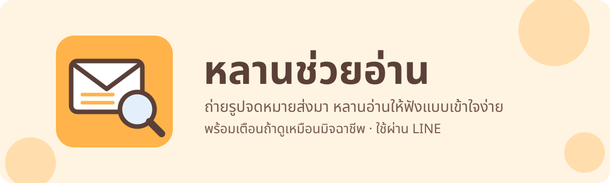
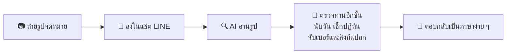
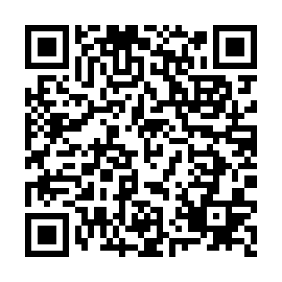

<picture>
  <source media="(prefers-color-scheme: dark)" srcset="assets/hero-dark.svg">
  
</picture>

  

  
  
  
  
  
  

จดหมายราชการอ่านยาก ทั้งภาษี ประกันสังคม ใบสั่ง หมายศาล อ่านไม่เข้าใจก็พลาดกำหนดจ่าย แถมมิจฉาชีพยังชอบปลอมจดหมายหน่วยงานรัฐมาหลอกให้โอนเงิน

**หลานช่วยอ่าน** คือเพื่อนใน LINE ที่ช่วยอ่านจดหมายพวกนี้ให้ แค่ถ่ายรูปส่งไป ไม่ต้องลงแอป ไม่ต้องสมัครอะไร

## ทำอะไรได้

| | |
|:--:|:--|
| 📄 | บอกว่า **จดหมายนี้คืออะไร** |
| ✅ | บอกว่า **ต้องทำอะไร** |
| ⏰ | บอกว่า **ภายในวันไหน** และนับให้ว่าเหลืออีกกี่วัน |
| 💰 | บอก **จำนวนเงิน** ที่ต้องจ่าย |
| 🚨 | **เตือนถ้าดูเหมือนมิจฉาชีพ** พร้อมบอกเหตุผล |

## หน้าตาคำตอบ

> 🚨 ระวัง! น่าจะเป็นมิจฉาชีพ
>
> 📄 หนังสือแจ้งค้างชำระภาษี (อ้างว่ามาจากกรมสรรพากร) 
> ✅ ต้องทำ: โอนเงินเข้าบัญชีตามที่ระบุ 
> ⏰ ภายใน: 3 วัน 
> 💰 จำนวนเงิน: 12,500 บาท
>
> เพราะ: 
> • บัญชีรับเงินเป็นชื่อบุคคล ไม่ใช่หน่วยงาน 
> • เร่งให้โอนภายในเวลาสั้น ๆ
>
> ห้ามโอนเงิน ห้ามกดลิงก์ ห้ามให้รหัส OTP หรือเลขบัตร 
> ปรึกษาลูกหลาน หรือโทรศูนย์ AOC 1441 ได้ตลอด 24 ชั่วโมง

ตัวอย่างจากจดหมายจำลอง ข้อมูลสมมติทั้งหมด

## ทำงานยังไง

## ลองเล่นได้เลย

<table>
  <tr>
    <td align="center" width="220">
       
      <b>@925iagtj</b>
    </td>
    <td>
      <ol>
        <li>สแกน QR ด้วยกล้องมือถือ หรือ<a href="https://line.me/R/ti/p/@925iagtj">กดลิงก์นี้</a> หรือค้นหา ID <code>@925iagtj</code> ใน LINE</li>
        <li>กด <b>เพิ่มเพื่อน</b></li>
        <li>ถ่ายรูปจดหมายให้เห็นทั้งแผ่น แล้วส่งเข้าแชต</li>
      </ol>
    </td>
  </tr>
</table>

> [!TIP]
> ควรปิดเลขบัตรประชาชนและเลขบัญชีก่อนถ่ายรูปส่ง

> [!WARNING]
> หลานช่วยอ่านช่วยดูเบื้องต้นเท่านั้น ยืนยันไม่ได้ว่าจดหมายจริงหรือปลอม ถ้าสงสัย โทรเช็กกับหน่วยงานตามเบอร์ทางการ (ไม่ใช่เบอร์ในจดหมาย) หรือโทรศูนย์ AOC 1441

## ความเป็นส่วนตัว

- ไม่เก็บรูป ไม่เก็บผล อ่านเสร็จแล้วทิ้ง ไม่มีฐานข้อมูล
- รูปจะถูกส่งให้ AI ของ Google อ่าน บริการแบบฟรีของ Google อาจนำข้อมูลไปพัฒนาระบบ

<b>เบื้องหลัง: ทำไมไม่เชื่อ AI 100%</b>

 

AI อ่านรูปเก่ง แต่ผิดได้ งานที่ต้องแม่นจึงให้ระบบทำเองอีกชั้น

| สิ่งที่ระบบทำเอง | ทำไม |
|:--|:--|
| นับว่าเหลืออีกกี่วัน | AI นับวันผิดได้ ผิดวันเดียวก็อาจพลาดเส้นตาย |
| เช็กวันในสัปดาห์กับปฏิทินจริง | จดหมายปลอมมักเขียนวันผิด เช่น "วันจันทร์ที่ 27" ที่จริงเป็นวันอังคาร |
| จับเบอร์โทร ลิงก์ และ LINE ID ในคำตอบ | กันมิจฉาชีพแอบเขียนในจดหมายให้บอตพิมพ์เบอร์ของตัวเองออกไป |
| ข้อความเตือนและเบอร์ AOC 1441 เป็นข้อความตายตัว | AI แก้ไม่ได้ และตรวจกับเว็บทางการแล้ว |
| ไม่มีคำว่า "ปลอดภัย" | ดูจากรูปอย่างเดียวยืนยันความจริงไม่ได้ จึงมีแค่ 3 ระดับ: มิจฉาชีพ / ไม่แน่ใจ / ไม่พบสัญญาณ |

<b>ผลทดสอบ</b>

 

ทดสอบกับจดหมายจำลอง (ข้อมูลสมมติ) ที่ทำให้เหมือนรูปถ่ายจากมือถือจริง เอียง มีเงา เบลอเล็กน้อย

| ชุด | เนื้อหา | ผล |
|:--|:--|:--:|
| ชุดง่าย 17 ใบ | จดหมายจริง 12 ใบ (ภาษี ค่าไฟ ใบสั่ง หมายศาล ฯลฯ) + มิจฉาชีพ 5 ใบ | 17/17 |
| ชุดยาก 12 ใบ | มิจฉาชีพเนียน ๆ, จดหมายจริงที่ดูน่ากลัว, รูปแย่หรือไม่ใช่จดหมาย | 11/12 → แก้แล้วผ่านครบ |
| เทสต์อัตโนมัติ | 51 ข้อ | ผ่านทั้งหมด |

ใบที่ยากที่สุดคือจดหมายภาษีปลอมที่สุภาพ ไม่มีลิงก์ ไม่ข่มขู่ สัญญาณเดียวคือชื่อบัญชีรับเงินเป็นบุคคลธรรมดา และบอตจับได้

## เจอปัญหา?

บอตอ่านผิด ตอบช้า หรือไม่ตอบ [แจ้งตรงนี้ได้เลย](https://github.com/Thinnaphat-tht/laan-chuay-aan-showcase/issues/new/choose)

ทำโดย Thinnaphat · Mahidol ICT

